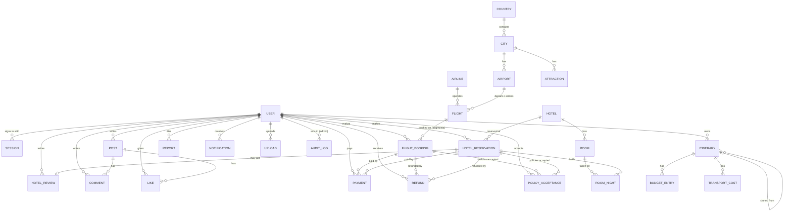
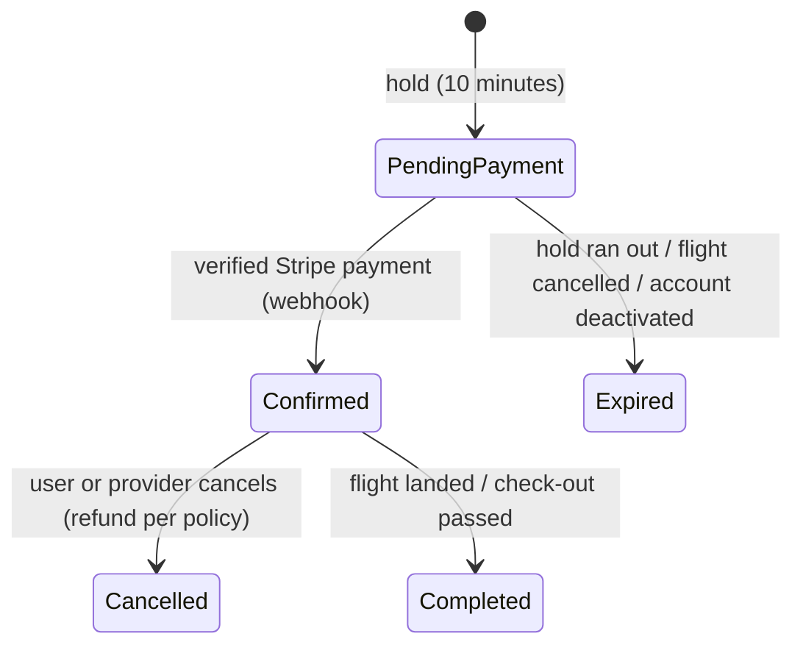

# Data Model (ERD)

The MongoDB collections as built for Milestone 1, taken from the Mongoose schemas in `backend/src/**/schemas` and `*.schema.ts`. Boxes are collections; embedded documents are listed under "Embedded" below rather than drawn as separate entities.

## Collections

| Collection | Owner module | Notes |
|---|---|---|
| `users` | users / auth | role (user, admin, airline/hotel moderator), `providerId` for moderators, status, lockout counter (ACC-05), preferred currency |
| `sessions` | auth | one per login; refresh-token id, last activity (30-minute idle expiry, ACC-06), revoked flag |
| `airlines` | flights | profile, logo, embedded baggage policy and cancellation tiers (FLT-01, FLT-08, FLT-09) |
| `airports` | flights (seeded) | official reference data with IANA time zone (FLT-02, GEN-06, GEN-12) |
| `flights` | flights | airline, airports, UTC times, status (FLT-30), embedded cabins with seat counters |
| `flightbookings` | flight-bookings | user, embedded segments, passengers, price, copied tiers and baggage terms, payment and refund summary (FLT-12..26) |
| `hotels` | hotels | profile, embedded photos, check-in/out times, cancellation tiers (HTL-01, HTL-02, HTL-09, HTL-10) |
| `rooms` | hotels | hotel, beds, occupancy, price, embedded availability and blocked ranges (HTL-03..06); optimistic concurrency |
| `hotel_reservations` | hotel-bookings | user, hotel, embedded reserved rooms, copied tiers, payment and refund summary (HTL-16..21) |
| `hotel_room_nights` | hotel-bookings | one row per room per night held or booked; unique (room, night) prevents overlaps (HTL-18) |
| `hotel_reviews` | hotel-bookings | one per completed reservation (HTL-23, HTL-24) |
| `payments` | payments | Stripe PaymentIntent id, amount, currency, status per booking (PAY-01); no card data |
| `refunds` | payments | Stripe refund id, percent, amount, status, kind (cancellation or rejected payment) (PAY-03) |
| `policyacceptances` | payments | provider policies accepted before payment, with timestamp (PAY-02) |
| `processedstripeevents` | payments | Stripe webhook events already handled (idempotency) |
| `notifications` | notifications | in-app notifications, read flag (GEN-01) |
| `itineraries` | itineraries | owner, countries, start date, visibility, embedded days and activities (with images), clone attribution (ITN-01..21) |
| `budget_entries`, `transport_costs` | itineraries/budget | amounts in their own currency per day / between cities (ITN-14, ITN-16) |
| `exchange_rates` | itineraries/budget | cached FXRatesAPI rates (ITN-18) |
| `posts`, `comments`, `likes` | blog | posts with embedded images and tags, draft/published, hidden flag; one like per user per post (BLG-01..12) |
| `reports` | blog/reports | content type and id, reason, open/resolved with the admin's resolution (GEN-09, GEN-10) |
| `auditlogs` | audit | admin actions: suspensions, password resets, provider changes, content moderation, report resolution (GEN-07) |
| `uploads` | uploads | stored image files, uploader, item kind, attached flag (GEN-08) |
| `countries`, `cities`, `attractions`, `currencies` | reference-data (seeded) | official reference datasets so IDs match the evaluation (GEN-12) |

## Embedded vs referenced

- **Embedded** (bounded, owned by the parent, read together): flight cabins; booking segments, passengers, price, copied cancellation tiers and baggage terms; reserved rooms; room availability and blocked ranges; itinerary days and activities; post images; hotel photos; airline baggage policy and tiers.
- **Referenced** (shared or changing on their own): users, airlines, airports, flights, hotels, rooms, reservations, payments, refunds, reviews, comments, likes, reports, notifications.
- Prices, baggage terms and cancellation tiers are **copied** onto bookings at hold time, so later provider edits do not change existing bookings (FLT-05, HTL-05).

## Booking lifecycle (GEN-11)

