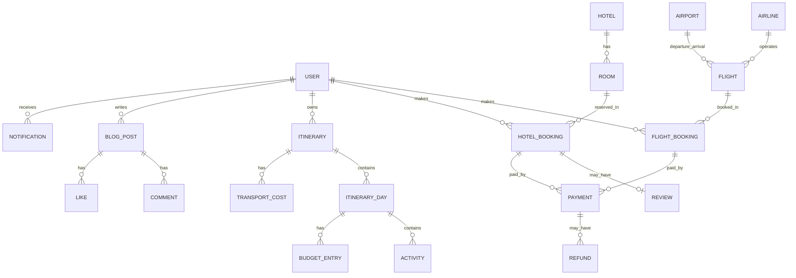

# Data Model (ERD)

Agree on the shared schemas on day 1, then keep this diagram updated. Replace or extend the starter below.

Notes to decide as a team: embedded vs referenced documents (passengers, cabins, availability), booking state machine (Held, Pending, Confirmed, Cancelled, Expired), and the Report, Audit Log and Moderator Assignment entities.
